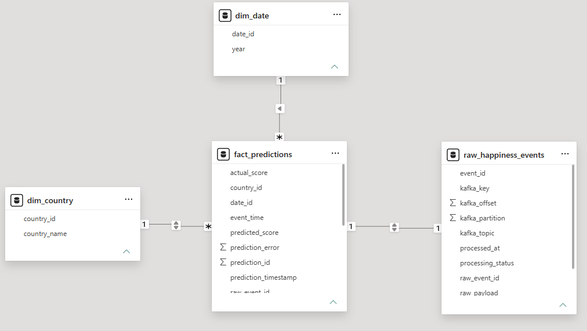
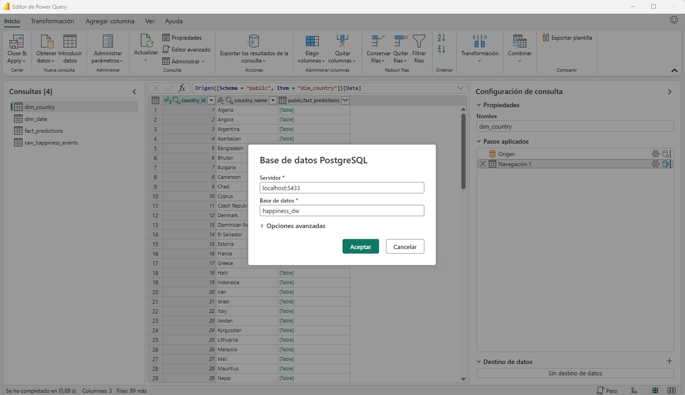
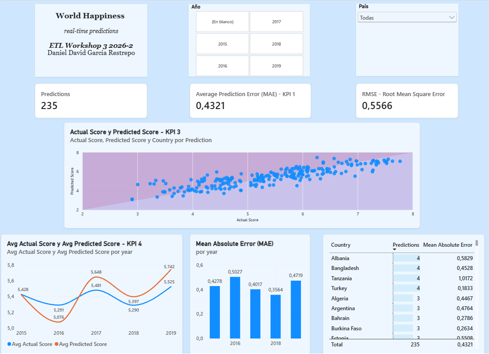
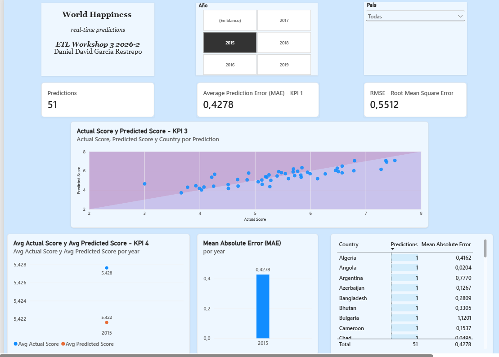
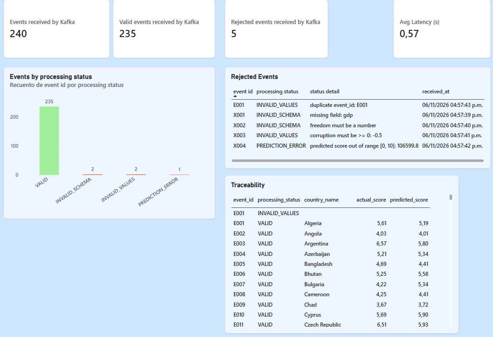
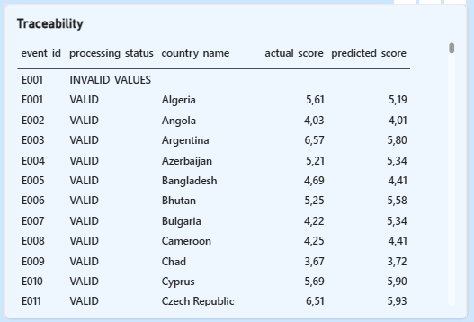
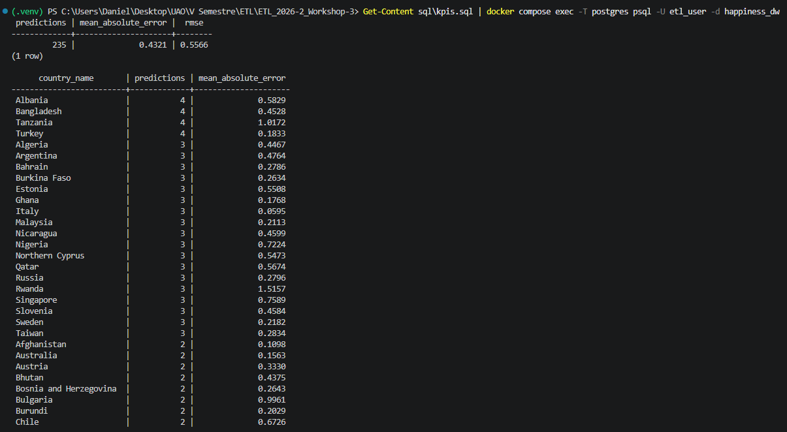

# Workshop-3 · Streaming ETL with Apache Kafka and Machine Learning

**Course:** ETL (G01) · Data Engineering and Artificial Intelligence · Universidad Autónoma de Occidente
**Author:** Daniel David Garcia Restrepo · **Spanish version:** [README_ES.md](README_ES.md)

---

## Contents

1. [Project description](#1-project-description)
2. [Repository structure](#2-repository-structure)
3. [Architecture](#3-architecture)
4. [Data cleaning decisions](#4-data-cleaning-decisions)
5. [Feature engineering decisions and model](#5-feature-engineering-decisions-and-model)
6. [Kafka pipeline and event contract](#6-kafka-pipeline-and-event-contract)
7. [Database schema](#7-database-schema)
8. [Dashboard](#8-dashboard)
9. [Execution instructions](#9-execution-instructions)
10. [Reproducibility notes](#10-reproducibility-notes)
11. [Limitations](#11-limitations)

---

## 1. Project description

This project builds an end-to-end **streaming ETL pipeline that generates real-time predictions of the World Happiness score**.

1. **Offline (batch) part.** The five World Happiness Report files (2015-2019) have different schemas. They are profiled, cleaned and harmonized into one unified dataset, and a simple regression model is trained and serialized together with its preprocessing in a scikit-learn `Pipeline` (`models/model.pkl`).
2. **Streaming part.** A Kafka **producer** replays held-out records one by one, as if they were arriving over time. A Kafka **consumer** stores every message untouched in a raw table, validates it against an explicit **event contract**, applies the same preprocessing used in training, predicts the happiness score with the serialized model and loads the result into PostgreSQL. Invalid events are kept in the raw table with a processing status and never stop the pipeline.
3. **Analytics part.** A Power BI dashboard queries the PostgreSQL database (never CSV files) to show the prediction error, the predictions by country, predicted vs actual scores and the trend over time, plus operational views of the pipeline.

The focus of the workshop is the **integration of the pipeline** (clean architecture, reproducibility, reliability and data consistency), not the accuracy of the model.

### Technology

| Component | Technology |
|---|---|
| Language | Python 3.12 |
| Streaming | Apache Kafka 4.4.0 (`apache/kafka:4.4.0`), `confluent-kafka` |
| Database | PostgreSQL 16 (`postgres:16`), `psycopg2` |
| Data and ML | pandas, NumPy, scikit-learn, joblib, matplotlib |
| Orchestration of the environment | Docker Compose |
| Dashboard | Power BI Desktop |

### Key results

| Item | Result |
|---|---|
| Raw data | 782 rows (158, 157, 155, 156, 156 per year) |
| Unified dataset | 781 rows × 9 columns, 164 countries (one incomplete row removed) |
| Model | `StandardScaler` + `LinearRegression`, 70/30 split (546 train / 235 test) |
| Test metrics | MAE **0.4321** · RMSE **0.5566** · R² **0.7519** |
| Streaming run | 235 events processed and predicted; MAE and RMSE computed in PostgreSQL and in Power BI match the test metrics of the notebook |
| Error demonstration | 5 hand-made faulty events: 2 `INVALID_SCHEMA`, 2 `INVALID_VALUES`, 1 `PREDICTION_ERROR`; the consumer never stopped |

---

## 2. Repository structure

```
.
├── README.md                    # this file (English)
├── README_ES.md                 # Spanish version
├── docker-compose.yml           # Kafka + PostgreSQL
├── requirements.txt             # pinned Python dependencies
├── .env.example                 # template of the database settings (copy to .env)
├── data/
│   ├── raw/                     # 2015.csv ... 2019.csv (original files)
│   ├── processed/
│   │   └── happiness_unified.csv        # output of eda.ipynb
│   └── streaming/
│       ├── happiness_stream.csv         # the 30% test split sent by the producer
│       └── happiness_stream_errors.csv  # 5 hand-made faulty records for the demo
├── notebooks/
│   ├── eda.ipynb                # EDA, cleaning and schema harmonization
│   └── model_training.ipynb     # feature engineering, training and evaluation
├── kafka/
│   ├── producer.py
│   └── consumer.py
├── models/
│   └── model.pkl                # serialized Pipeline (scaler + regressor)
├── sql/
│   ├── create_tables.sql        # database schema
│   └── kpis.sql                 # dashboard KPIs and operational queries
├── dashboards/
│   ├── happiness_dashboard.pbix
│   ├── happiness_dashboard.pdf
│   └── screenshots/             # evidence used in section 8
└── docs/
    └── ETL-G01_2026-2_Workshop-3.pdf    # official guide
```

---

## 3. Architecture

```
OFFLINE (batch, run once)

 data/raw/2015..2019.csv
        |
        v   notebooks/eda.ipynb: profile, clean, harmonize
 data/processed/happiness_unified.csv         (781 rows, 9 columns)
        |
        v   notebooks/model_training.ipynb: features, 70/30 split,
        |   Pipeline(StandardScaler + LinearRegression)
        +--> models/model.pkl                 (preprocessing + model)
        +--> data/streaming/happiness_stream.csv   (30% test split, 235 records)


STREAMING (continuous)

 happiness_stream.csv --> kafka/producer.py --> Kafka topic "happiness-events"
                                               (3 partitions, key = country)
                                                          |
                                                          v
                                  kafka/consumer.py   (consumer group "happiness-ml-team")
   1. store the original message ........ raw_happiness_events   (status RECEIVED)
   2. validate the event contract ........ INVALID_SCHEMA / INVALID_VALUES  (stop here)
   3. same features and preprocessing .... models/model.pkl
   4. predict + range check [0, 10] ...... PREDICTION_ERROR on failure
   5. store the result ................... dim_country, fact_predictions, status VALID
                                                          |
                                                          v
                                        PostgreSQL (happiness_dw) --> Power BI dashboard
```

### Main design decisions

| Decision | Reason |
|---|---|
| The producer sends only the 30% **test split** | If it sent records the model was trained on, the "average prediction error" KPI would be falsely optimistic |
| The model and its preprocessing are **one serialized `Pipeline`** | The consumer loads one object, so training and streaming apply exactly the same preprocessing |
| `country` is the Kafka key | Events of the same country always go to the same partition (per-country ordering) |
| The raw message is stored **before** validation, as `TEXT` | It keeps the message exactly as it arrived (even malformed JSON), which `JSONB` would reject or rewrite. It gives traceability and allows reprocessing |
| Every event ends in a final status | Invalid events are stored, skipped from prediction and never crash the consumer |
| The consumer reads the feature names and their order from the model (`feature_names_in_`) | Training and streaming cannot drift apart |
| PostgreSQL runs in Docker Compose | One command reproduces the environment; Power BI connects to the published port |

---

## 4. Data cleaning decisions

All the profiling and cleaning is done in [`notebooks/eda.ipynb`](notebooks/eda.ipynb). The notebook checks every figure below with `assert` statements and keeps a **data quality register** (section 13 of the notebook).

### Findings in the raw files

| Aspect | Finding |
|---|---|
| Rows | 158 (2015), 157 (2016), 155 (2017), 156 (2018), 156 (2019) = 782 |
| Year | No file has a year column; it only exists in the file name |
| Column names | The same indicator is written in three ways, e.g. `Economy (GDP per Capita)`, `Economy..GDP.per.Capita.` and `GDP per capita` |
| Schema | Columns exist only in some years: region (2015-2016), standard error (2015), confidence intervals (2016), whiskers (2017), dystopia residual (2015-2017) |
| Data types | The 2018 file contains the text `N/A` in a numeric column |
| Missing values | One: United Arab Emirates 2018, corruption |
| Duplicates | None (neither full rows nor repeated country-year pairs) |
| Country names | 170 distinct names for 164 countries (six countries are written in two ways) |
| Zeros | 30 rows (3.8%) have a 0 in at least one indicator |
| Outliers (1.5 × IQR) | corruption 67 (8.58%), generosity 17 (2.18%), family 10 (1.28%); the other variables none |
| Scale | The six indicators share the same range in every year |

### Decisions and justification

| # | Decision | Justification |
|---|---|---|
| 1 | Clean the column names in **two stages** | Stage 1 (mechanical): lowercase, dots and parentheses removed, any run of spaces or punctuation becomes one underscore. `Economy (GDP per Capita)` and `Economy..GDP.per.Capita.` both become `economy_gdp_per_capita`. Stage 2 (semantic): the 2018-2019 files use different words, so every cleaned name is mapped to a unified name: `country`, `score`, `gdp`, `family`, `health`, `freedom`, `generosity`, `corruption` |
| 2 | Add `year` from the file name | It is required by the event contract and by the time analysis |
| 3 | Exclude ranks, standard error, confidence intervals, whiskers and dystopia residual | They are derived from the score: target leakage. In 2015-2017 the score equals the six indicators plus the dystopia residual (maximum difference 0.0005), so that column would make the prediction trivial |
| 4 | Exclude `region` | It exists only in 2015-2016 and it is not part of the event contract |
| 5 | Unify six country names (170 → 164) | `country` is the Kafka key and feeds `dim_country`: each country needs one spelling in all years |
| 6 | Remove the United Arab Emirates 2018 row | It is 1 of 782 rows (0.13%). Replacing `N/A` with 0 would tell the model that the corruption indicator is literally zero, and real zeros exist in the data. The event contract also requires numeric values |
| 7 | Keep outliers and zeros | They are valid observations inside the bounded range of each indicator (the same countries repeat across years, e.g. Greece has generosity = 0 in all five years); removing them would delete real countries |
| 8 | No rescaling between years | The indicators already share the same range; any scaling belongs to the model pipeline |
| 9 | Assumption documented | `Family` and `Social support`, and `Trust (Government Corruption)` and `Perceptions of corruption`, are treated as the same indicator under a new name |

### Column harmonization

| Unified column | 2015-2016 | 2017 | 2018-2019 |
|---|---|---|---|
| `country` | Country | Country | Country or region |
| `score` (target) | Happiness Score | Happiness.Score | Score |
| `gdp` | Economy (GDP per Capita) | Economy..GDP.per.Capita. | GDP per capita |
| `family` | Family | Family | Social support |
| `health` | Health (Life Expectancy) | Health..Life.Expectancy. | Healthy life expectancy |
| `freedom` | Freedom | Freedom | Freedom to make life choices |
| `generosity` | Generosity | Generosity | Generosity |
| `corruption` | Trust (Government Corruption) | Trust..Government.Corruption. | Perceptions of corruption |

### The six country-name cases (170 → 164 distinct names)

| # | Replaced name (years) | Kept name (years) | Criterion |
|---|---|---|---|
| 1 | Hong Kong S.A.R., China (2017) | Hong Kong (2015, 2016, 2018, 2019) | Most recent and most common form |
| 2 | Taiwan Province of China (2017) | Taiwan (2015, 2016, 2018, 2019) | Most recent and most common form |
| 3 | North Cyprus (2015-2017) | Northern Cyprus (2018-2019) | Most recent form |
| 4 | Macedonia (2015-2018) | North Macedonia (2019) | Most recent form (official name since 2019) |
| 5 | Trinidad & Tobago (2018-2019) | Trinidad and Tobago (2015-2017) | **Exception to "most recent"**: `&` is an abbreviation; the full-word form avoids a special character in the Kafka key and in the database |
| 6 | Somaliland region (2015) | Somaliland Region (2016) | Most recent form; only the capital R differs |

**Output:** `data/processed/happiness_unified.csv` — 781 rows, columns `country, year, gdp, family, health, freedom, generosity, corruption, score`; 164 countries, 145 of them present in all five years (the panel is unbalanced).

---

## 5. Feature engineering decisions and model

Implemented in [`notebooks/model_training.ipynb`](notebooks/model_training.ipynb), which also contains the descriptive statistics and visualizations (correlation matrix, scatter plots, predicted vs actual).

### Relationships found

Correlation with the score: `gdp` 0.79, `health` 0.74, `family` 0.65, `freedom` 0.55, `corruption` 0.40, `generosity` 0.14. The indicators are also correlated with each other (e.g. `gdp` with `health`, 0.79).

### Feature decisions

| Column | Role | Justification |
|---|---|---|
| `gdp`, `family`, `health`, `freedom`, `generosity`, `corruption` | Features | The six numeric fields of the event contract, so the consumer can always provide them. `generosity` has the weakest relationship but is kept because it is part of the contract and costs nothing in a linear model |
| `score` | Target | Sent as `actual_happiness_score` in the event; used only for training and evaluation, **never as an input** |
| `country`, `year` | Identifiers, not features | `country` has 164 values: one-hot encoding would create 164 columns, the model would memorize countries (the same country appears in several years) and unseen countries could arrive in the stream. `year` identifies the period; it does not explain the score |

- **Categorical data:** not needed (see above).
- **Scaling:** a `StandardScaler` is part of the `Pipeline`. Ordinary least squares does not need scaling to fit, but the scaler makes the coefficients comparable and keeps the preprocessing inside the serialized object.
- **Target leakage:** avoided (decisions 3 and 4 of the cleaning section).

### Model and evaluation

- **Model:** `Pipeline([StandardScaler, LinearRegression])`, chosen beforehand as the simplest of the suggested models. Saved with `joblib` as `models/model.pkl`.
- **Split:** 70% / 30%, `random_state=42` → 546 train rows and 235 test rows.

| Metric | Train | Test |
|---|---|---|
| MAE | 0.4225 | 0.4321 |
| RMSE | 0.5448 | 0.5566 |
| R² | 0.7675 | 0.7519 |

Train and test metrics are close, so the model is stable. The score is not reproduced perfectly because the dystopia residual (the remainder of the score) is excluded on purpose. The standardized coefficients are `gdp` 0.431, `health` 0.267, `freedom` 0.249, `family` 0.210, `corruption` 0.099 and `generosity` 0.068.

**Reference comparison** (the final model was chosen beforehand, not from this table):

| Model | Test MAE | Test RMSE | Train R² | Test R² |
|---|---|---|---|---|
| Linear Regression | 0.432 | 0.557 | 0.768 | 0.752 |
| Decision Tree | 0.489 | 0.651 | 1.000 | 0.660 |
| Random Forest | 0.383 | 0.489 | 0.973 | 0.809 |

The Random Forest scores somewhat better on the test split but memorizes the training rows (train R² 0.973 vs test 0.809). Linear Regression is stable, simple to explain and sufficient for a workshop about pipeline integration.

---

## 6. Kafka pipeline and event contract

### Topic and consumer group

| Item | Value |
|---|---|
| Broker | Apache Kafka 4.4.0, single local broker, `localhost:9092` |
| Topic | `happiness-events`, 3 partitions, replication factor 1 |
| Event key | `country` |
| Consumer group | `happiness-ml-team` (`auto.offset.reset = earliest`) |

### Producer (`kafka/producer.py`)

- Reads a CSV **record by record**, builds a JSON event and sends it with `country` as the key, waiting a configurable delay between events.
- `event_id` is generated (`E001`, `E002`...); `event_time` is the moment the producer emits the event.
- An **empty cell omits the key** and an `event_id` written in the file is used as is; text in a numeric field is kept as text. This is how the faulty records are built.
- Before sending, it checks that the topic exists with 3 partitions (otherwise Kafka could auto-create it with a single one).

| Argument | Default | Meaning |
|---|---|---|
| `--file` | `data/streaming/happiness_stream.csv` | CSV to send |
| `--delay` | `0.5` | Seconds between events |
| `--id-prefix` | `E` | Prefix of the generated ids (the errors file uses `X`) |

### Event format

```json
{
  "event_id": "E001",
  "country": "Algeria",
  "year": 2015,
  "gdp": 0.93929,
  "family": 1.07772,
  "health": 0.61766,
  "freedom": 0.28579,
  "generosity": 0.07822,
  "corruption": 0.17383,
  "actual_happiness_score": 5.605,
  "event_time": "2026-11-05T03:00:00"
}
```

### Event contract

Kafka only transports the record; the application is responsible for interpreting and validating the business fields.

| Field | Type | Rule | If violated |
|---|---|---|---|
| `event_id` | string | Present, not empty, unique among accepted events (traceability) | missing / wrong type → `INVALID_SCHEMA`; empty or repeated → `INVALID_VALUES` |
| `country` | string | Present, not empty; also the Kafka key | missing / wrong type → `INVALID_SCHEMA`; empty → `INVALID_VALUES` |
| `year` | integer | Present; must exist in `dim_date` (2015-2019) | missing / not an integer → `INVALID_SCHEMA`; not in `dim_date` → `INVALID_VALUES` |
| `gdp`, `family`, `health`, `freedom`, `generosity`, `corruption` | number | Present, finite and `>= 0` (no upper bound) | missing / not a number → `INVALID_SCHEMA`; negative or not finite → `INVALID_VALUES` |
| `actual_happiness_score` | number | Present, finite, between 0 and 10; **evaluation only, never a model input** | missing / not a number → `INVALID_SCHEMA`; out of range → `INVALID_VALUES` |
| `event_time` | string | Present, valid ISO-8601 timestamp: the moment the producer emitted the event | missing / not a string → `INVALID_SCHEMA`; not ISO-8601 → `INVALID_VALUES` |

Also: a payload that is not valid JSON, or not a JSON object, is `INVALID_SCHEMA`. The features required by the model are read from the model itself and checked against the contract when the consumer starts.

### Consumer (`kafka/consumer.py`)

For every message, in this order:

1. **Receive** the event.
2. **Store the raw message** in `raw_happiness_events` (status `RECEIVED`) before any validation or prediction.
3. **Validate** it against the contract.
4. **Apply the same feature order and preprocessing as in training** (the `Pipeline` does it).
5. **Load the serialized model** (once, at start-up).
6. **Predict** the score. A predicted score outside [0, 10] is rejected as a safety net.
7. **Store the result**: the country in `dim_country` (if new), the row in `fact_predictions` and the final status in the raw table, in one transaction.

### Processing statuses

| Status | Meaning | Prediction |
|---|---|---|
| `RECEIVED` | Transient: stored, not finished yet. A row that stays here means the consumer stopped in the middle of that event | — |
| `VALID` | Passed validation and was predicted and stored | Yes |
| `INVALID_SCHEMA` | Not valid JSON, missing field or wrong data type | Skipped |
| `INVALID_VALUES` | Right structure but invalid values (negative, empty, unknown year, repeated `event_id`...) | Skipped |
| `PREDICTION_ERROR` | Valid event, but the prediction failed or fell outside [0, 10] | Not stored |

Invalid events **stay in the raw table with the reason** (`status_detail`), are skipped from prediction and never stop the consumer. Any unexpected error is printed and the loop continues.

### Reliability behaviour

- A Kafka record that was already stored (same topic, partition and offset) is skipped, and a row left in `RECEIVED` by a previous run is processed again.
- The safety net for absurd values: the indicators have no upper bound, but the prediction is checked against [0, 10]. For example `gdp = 99999` produces a prediction of about 106,600 and is rejected as `PREDICTION_ERROR`.

### Error demonstration (`data/streaming/happiness_stream_errors.csv`)

| Record | Defect | Expected status |
|---|---|---|
| `X001` (Colombia) | Empty `gdp` cell → the key is omitted | `INVALID_SCHEMA` |
| `X002` (Chile) | Text `alto` in `freedom` | `INVALID_SCHEMA` |
| `X003` (Peru) | `corruption` = -0.5 | `INVALID_VALUES` |
| `X004` (Brazil) | `gdp` = 99999 | `PREDICTION_ERROR` |
| `E001` (Algeria) | Repeats the `event_id` of the first clean event | `INVALID_VALUES` |

---

## 7. Database schema

PostgreSQL 16, database `happiness_dw`, schema `public`. Script: [`sql/create_tables.sql`](sql/create_tables.sql) (it can be run more than once).

```
                 dim_country                         dim_date
                 -----------                         --------
                 country_id (PK)                     date_id (PK = year)
                 country_name (UNIQUE)               year (UNIQUE)
                       ^                                   ^
                       |                                   |
                       +------------ fact_predictions -----+
                                     ----------------
                                     prediction_id (PK)
                                     raw_event_id  (FK, UNIQUE) ----> raw_happiness_events
                                     country_id    (FK)
                                     date_id       (FK)
                                     actual_score, predicted_score, prediction_error
                                     event_time, prediction_timestamp
```

| Table | Purpose | Main columns |
|---|---|---|
| `raw_happiness_events` | Raw / staging table (not a dimension): every Kafka message exactly as received | `raw_event_id` (PK), `kafka_topic`, `kafka_partition`, `kafka_offset`, `kafka_key`, `raw_payload` (TEXT), `event_id`, `processing_status`, `status_detail`, `received_at`, `processed_at` |
| `dim_country` | One row per country; added by the consumer the first time it appears in a valid event | `country_id` (PK), `country_name` (UNIQUE) |
| `dim_date` | One row per historical year of the report | `date_id` (PK, equal to the year), `year` |
| `fact_predictions` | One row per event that was predicted successfully | `prediction_id` (PK), `raw_event_id`, `country_id`, `date_id`, `actual_score`, `predicted_score`, `prediction_error`, `event_time`, `prediction_timestamp` |

Design notes:

- `dim_date` is keyed by the **historical year** (2015-2019), because the time KPI analyses the years of the report, not the technical moment of the event. `event_time` and `prediction_timestamp` are audit columns of the fact table.
- `fact_predictions.raw_event_id` is unique and linked to the raw table: every prediction can be traced back to the exact message that produced it.
- Constraints: allowed statuses (`CHECK`), unique Kafka position (`topic, partition, offset`), foreign keys to both dimensions and the raw table.
- `prediction_error = actual_score - predicted_score` (signed). KPIs use `ABS(prediction_error)`, because a signed average cancels out.
- All timestamps are naive local time written by the Python scripts (the same clock as `event_time`), so they can be compared directly.

---

## 8. Dashboard

Built in **Power BI Desktop** and connected to PostgreSQL (`localhost:5433`, database `happiness_dw`). It queries the database, **never CSV files**. The reference definition of each KPI is in [`sql/kpis.sql`](sql/kpis.sql).

- File: [`dashboards/happiness_dashboard.pbix`](dashboards/happiness_dashboard.pbix) · PDF export: [`dashboards/happiness_dashboard.pdf`](dashboards/happiness_dashboard.pdf)
- The `.pbix` stores the server and database name, not the password.

### Data model

Star schema with `fact_predictions` in the centre: `fact_predictions[country_id]` → `dim_country[country_id]` (many to one), `fact_predictions[date_id]` → `dim_date[date_id]` (many to one) and `fact_predictions[raw_event_id]` ↔ `raw_happiness_events[raw_event_id]` (one to one, traceability).




### Page 1: Prediction KPIs




| KPI | Definition | Visual |
|---|---|---|
| **1. Average prediction error** | Mean of `ABS(prediction_error)` (mean absolute error, MAE). RMSE is shown next to it to compare with the notebook | Cards |
| **2. Predictions by country** | Number of predictions and MAE per country | Table |
| **3. Predicted vs actual score** | One point per prediction (X = actual, Y = predicted); points close to the diagonal are accurate | Scatter chart |
| **4. Prediction trends over time** | Average actual and average predicted score by historical year, plus MAE by year | Line chart and columns |

Year and country slicers filter the whole page. With no filter the cards show **235 predictions, MAE 0.4321 and RMSE 0.5566**, identical to the test metrics of `model_training.ipynb` and to the result of `sql/kpis.sql`.

### Page 2: Pipeline operations




Cards (raw events, valid, rejected, average latency), raw events by processing status, the list of rejected events with the reason, and a traceability table from the raw event to its prediction. After the full demonstration there are 240 raw events: 235 `VALID`, 2 `INVALID_SCHEMA`, 2 `INVALID_VALUES` and 1 `PREDICTION_ERROR`.

### Cross-check with SQL



---

## 9. Execution instructions

### Requirements

- Windows with PowerShell (the commands below are for PowerShell; run them from the project root)
- Docker Desktop (WSL2 backend), Python 3.12, Git
- Power BI Desktop (only to open the dashboard)

The images `apache/kafka:4.4.0` and `postgres:16` are downloaded the first time.

### 1. Python environment

```powershell
py -3.12 -m venv .venv
.\.venv\Scripts\Activate.ps1
python -m pip install -r requirements.txt
```

### 2. Settings

```powershell
Copy-Item .env.example .env
```

Edit `.env` and set `POSTGRES_PASSWORD`. The file is not versioned. `POSTGRES_PORT` is the **host** port of PostgreSQL (5433 by default, so it does not collide with a local PostgreSQL on 5432); change it if it is busy.

### 3. Start Kafka and PostgreSQL

```powershell
docker compose up -d
docker compose ps
```

Wait until PostgreSQL shows `healthy`.

### 4. Create the tables and the topic

```powershell
Get-Content sql\create_tables.sql | docker compose exec -T postgres psql -U etl_user -d happiness_dw -v ON_ERROR_STOP=1
```

```powershell
docker compose exec kafka /opt/kafka/bin/kafka-topics.sh --create --if-not-exists --topic happiness-events --partitions 3 --replication-factor 1 --bootstrap-server localhost:9092
```

If you changed `POSTGRES_USER` or `POSTGRES_DB` in `.env`, use those values in the first command.

### 5. (Optional) Regenerate the data and the model

The processed dataset, the streaming files and `models/model.pkl` are already in the repository. To regenerate them, run the notebooks with the `.venv` kernel, in this order: `notebooks/eda.ipynb` and then `notebooks/model_training.ipynb`.

`model.pkl` must be loaded with the scikit-learn version it was saved with, which is pinned in `requirements.txt`.

### 6. Run the streaming pipeline

Terminal A (consumer, start it first):

```powershell
.\.venv\Scripts\Activate.ps1
python kafka\consumer.py
```

Terminal B (producer, 235 events, about two minutes at the default delay):

```powershell
.\.venv\Scripts\Activate.ps1
python kafka\producer.py
```

You will see `PROCESSED | E001 | Algeria 2015 | actual ... | predicted ...` lines in the consumer. When it has processed everything, send the faulty records:

```powershell
python kafka\producer.py --file data\streaming\happiness_stream_errors.csv --id-prefix X --delay 1
```

The consumer prints a `REJECTED | ... | <status> | <reason>` line for each of them. Stop it with `Ctrl + C`; it prints a summary per status.

### 7. Verify

```powershell
docker compose exec postgres psql -U etl_user -d happiness_dw -c "SELECT processing_status, COUNT(*) FROM raw_happiness_events GROUP BY 1 ORDER BY 1;"
```

Expected: `INVALID_SCHEMA` 2, `INVALID_VALUES` 2, `PREDICTION_ERROR` 1, `VALID` 235. To run all the KPI queries:

```powershell
Get-Content sql\kpis.sql | docker compose exec -T postgres psql -U etl_user -d happiness_dw
```

The first query must return **235 predictions, MAE 0.4321 and RMSE 0.5566**.

### 8. Dashboard

Open `dashboards/happiness_dashboard.pbix` with Power BI Desktop and click *Refresh* (the stack must be running; Power BI asks for the database credentials). To build it from scratch: *Get data → PostgreSQL database*, server `localhost:5433`, database `happiness_dw`, *Import* mode, load the four tables and create the relationships of section 8.

### Repeating a run

Kafka has no volume, so the topic disappears with the container. If you delete and recreate the topic, Kafka positions start at 0 again, and the tables must be reset too, otherwise the consumer would skip the new events as already stored. This deletes the raw events, predictions and countries (`dim_date` is kept):

```powershell
docker compose exec postgres psql -U etl_user -d happiness_dw -c "TRUNCATE raw_happiness_events, fact_predictions, dim_country RESTART IDENTITY;"
```

### Stop

```powershell
docker compose down
```

This keeps the PostgreSQL data (named volume) and discards the Kafka topic. `docker compose down -v` also deletes the PostgreSQL data.

---

## 10. Reproducibility notes

- Exact package versions in `requirements.txt`; fixed Docker image versions (`apache/kafka:4.4.0`, `postgres:16`, never `latest`).
- Fixed random seed (`random_state=42`) for the split and the reference models.
- No credentials in the code or in the repository: settings come from `.env` (`.env.example` is the template); Docker Compose fails with a clear message if a required variable is missing.
- The notebooks resolve all paths from the project root and can be run again from start to end.
- The SQL script creates only what is missing, so it can be run repeatedly.
- The producer verifies the topic before sending; the consumer verifies that the tables and the model exist.

## 11. Limitations

- **Random split by row:** the same country can appear in train and test in different years. A country changes little from one year to the next, so the test error can be slightly optimistic. Accepted because the focus is the pipeline.
- **Unbalanced panel:** 19 of the 164 countries do not appear in all five years.
- **No upper bound on the indicators** in the validation; the range check on the predicted score is the safety net.
- **Local environment:** one broker with replication factor 1 and no persistent volume for Kafka (the topic must be created again after the container is removed).
- **Delivery semantics:** the consumer uses the default offset commit. Re-reads are harmless thanks to the unique Kafka position and the repeated-`event_id` check, but this is not an exactly-once design.
- **Dashboard:** Power BI works in *Import* mode, so it must be refreshed after new events are processed.
