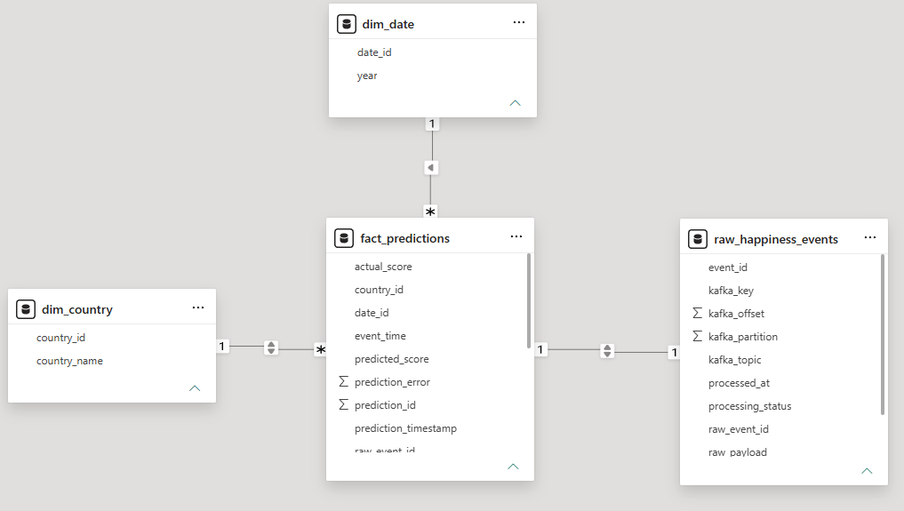
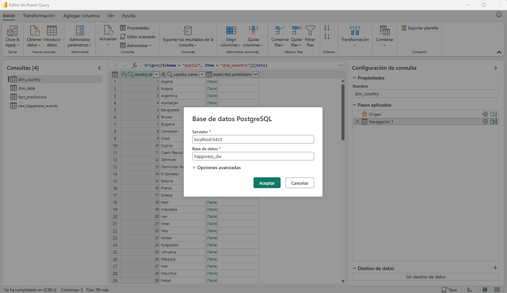
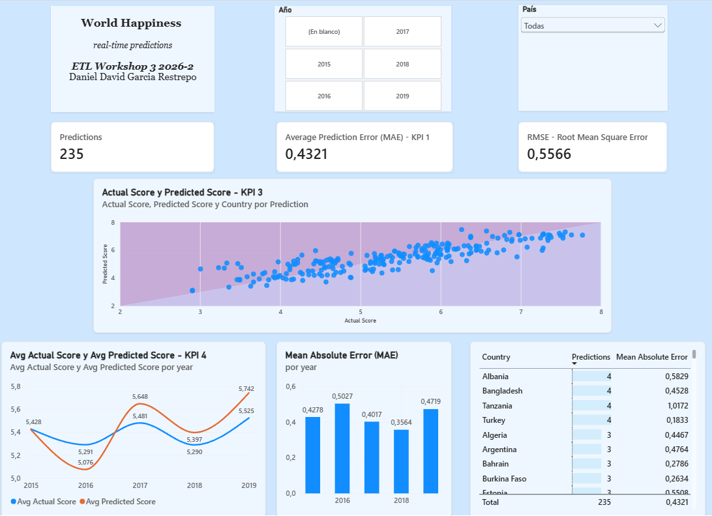
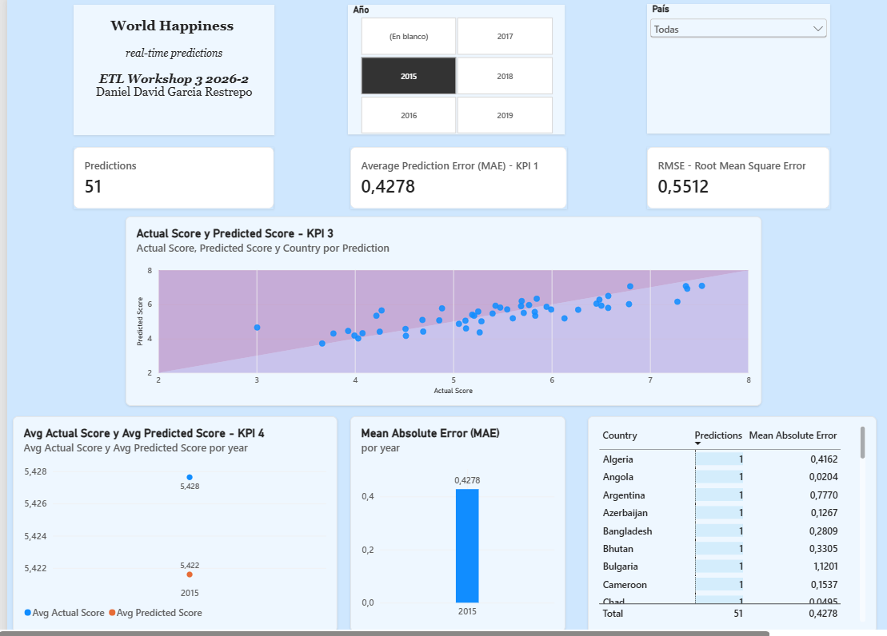
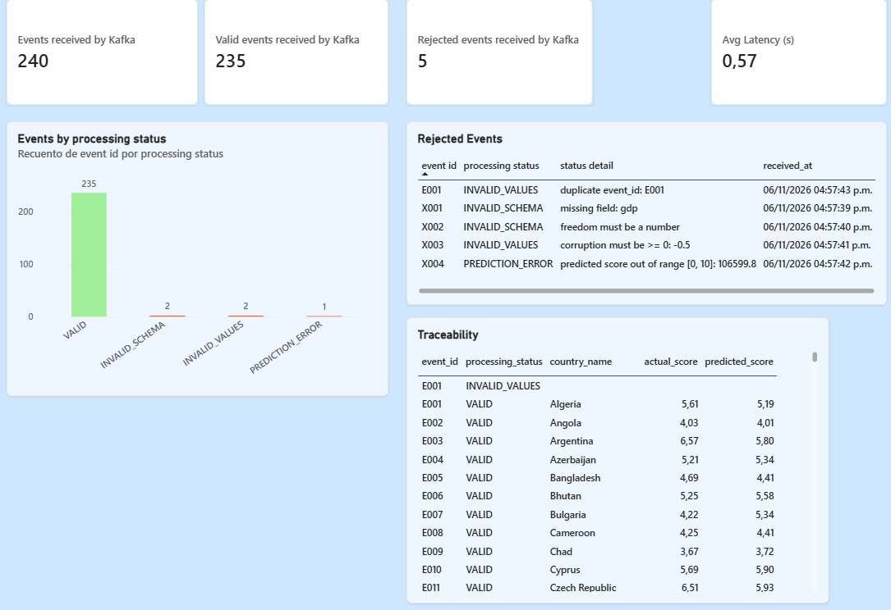
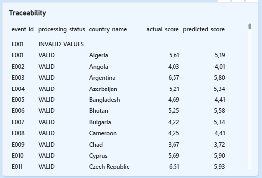
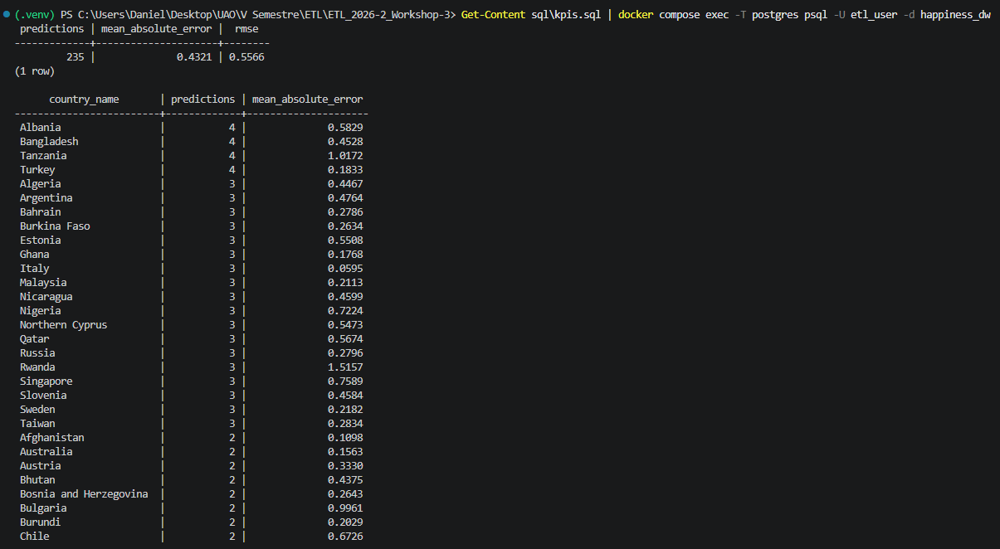

# Workshop-3 · ETL de streaming con Apache Kafka y Machine Learning

**Curso:** ETL (G01) · Ingeniería de Datos e Inteligencia Artificial · Universidad Autónoma de Occidente
**Autor:** Daniel David Garcia Restrepo · **Versión en inglés:** [README.md](README.md)

---

## Contenido

1. [Descripción del proyecto](#1-descripción-del-proyecto)
2. [Estructura del repositorio](#2-estructura-del-repositorio)
3. [Arquitectura](#3-arquitectura)
4. [Decisiones de limpieza de datos](#4-decisiones-de-limpieza-de-datos)
5. [Decisiones de ingeniería de características y modelo](#5-decisiones-de-ingeniería-de-características-y-modelo)
6. [Pipeline de Kafka y contrato de eventos](#6-pipeline-de-kafka-y-contrato-de-eventos)
7. [Esquema de la base de datos](#7-esquema-de-la-base-de-datos)
8. [Dashboard](#8-dashboard)
9. [Instrucciones de ejecución](#9-instrucciones-de-ejecución)
10. [Notas de reproducibilidad](#10-notas-de-reproducibilidad)
11. [Limitaciones](#11-limitaciones)

---

## 1. Descripción del proyecto

Este proyecto construye un **pipeline ETL de streaming de extremo a extremo que genera predicciones en tiempo real del puntaje de felicidad (World Happiness)**.

1. **Parte offline (por lotes).** Los cinco archivos del World Happiness Report (2015-2019) tienen esquemas distintos. Se perfilan, se limpian y se armonizan en un único conjunto de datos, y se entrena un modelo de regresión simple que se serializa junto con su preprocesamiento en un `Pipeline` de scikit-learn (`models/model.pkl`).
2. **Parte de streaming.** Un **producer** de Kafka reproduce registros reservados para prueba, uno a uno, como si llegaran con el tiempo. Un **consumer** de Kafka guarda cada mensaje intacto en una tabla cruda, lo valida contra un **contrato de eventos** explícito, aplica el mismo preprocesamiento del entrenamiento, predice el puntaje con el modelo serializado y carga el resultado en PostgreSQL. Los eventos inválidos se conservan en la tabla cruda con un estado de procesamiento y nunca detienen el pipeline.
3. **Parte analítica.** Un dashboard de Power BI consulta la base de datos PostgreSQL (nunca archivos CSV) para mostrar el error de predicción, las predicciones por país, el puntaje predicho frente al real y la tendencia en el tiempo, además de vistas operativas del pipeline.

El foco del workshop es la **integración del pipeline** (arquitectura limpia, reproducibilidad, confiabilidad y consistencia de los datos), no la precisión del modelo.

### Tecnología

| Componente | Tecnología |
|---|---|
| Lenguaje | Python 3.12 |
| Streaming | Apache Kafka 4.4.0 (`apache/kafka:4.4.0`), `confluent-kafka` |
| Base de datos | PostgreSQL 16 (`postgres:16`), `psycopg2` |
| Datos y ML | pandas, NumPy, scikit-learn, joblib, matplotlib |
| Entorno | Docker Compose |
| Dashboard | Power BI Desktop |

### Resultados clave

| Elemento | Resultado |
|---|---|
| Datos originales | 782 filas (158, 157, 155, 156 y 156 por año) |
| Conjunto unificado | 781 filas × 9 columnas, 164 países (se eliminó una fila incompleta) |
| Modelo | `StandardScaler` + `LinearRegression`, partición 70/30 (546 entrenamiento / 235 prueba) |
| Métricas en prueba | MAE **0.4321** · RMSE **0.5566** · R² **0.7519** |
| Ejecución de streaming | 235 eventos procesados y predichos; el MAE y el RMSE calculados en PostgreSQL y en Power BI coinciden con las métricas de prueba del notebook |
| Demostración de errores | 5 eventos defectuosos hechos a mano: 2 `INVALID_SCHEMA`, 2 `INVALID_VALUES` y 1 `PREDICTION_ERROR`; el consumer nunca se detuvo |

---

## 2. Estructura del repositorio

```
.
├── README.md                    # versión en inglés
├── README_ES.md                 # este archivo (español)
├── docker-compose.yml           # Kafka + PostgreSQL
├── requirements.txt             # dependencias de Python con versión fija
├── .env.example                 # plantilla de la configuración de la base (copiar a .env)
├── data/
│   ├── raw/                     # 2015.csv ... 2019.csv (archivos originales)
│   ├── processed/
│   │   └── happiness_unified.csv        # salida de eda.ipynb
│   └── streaming/
│       ├── happiness_stream.csv         # el 30% de prueba que envía el producer
│       └── happiness_stream_errors.csv  # 5 registros defectuosos hechos a mano
├── notebooks/
│   ├── eda.ipynb                # EDA, limpieza y armonización del esquema
│   └── model_training.ipynb     # ingeniería de características, entrenamiento y evaluación
├── kafka/
│   ├── producer.py
│   └── consumer.py
├── models/
│   └── model.pkl                # Pipeline serializado (escalador + regresor)
├── sql/
│   ├── create_tables.sql        # esquema de la base de datos
│   └── kpis.sql                 # KPIs del dashboard y consultas operativas
├── dashboards/
│   ├── happiness_dashboard.pbix
│   ├── happiness_dashboard.pdf
│   └── screenshots/             # evidencia usada en la sección 8
└── docs/
    └── ETL-G01_2026-2_Workshop-3.pdf    # guía oficial
```

---

## 3. Arquitectura

```
OFFLINE (por lotes, se ejecuta una vez)

 data/raw/2015..2019.csv
        |
        v   notebooks/eda.ipynb: perfilar, limpiar, armonizar
 data/processed/happiness_unified.csv         (781 filas, 9 columnas)
        |
        v   notebooks/model_training.ipynb: características, partición 70/30,
        |   Pipeline(StandardScaler + LinearRegression)
        +--> models/model.pkl                 (preprocesamiento + modelo)
        +--> data/streaming/happiness_stream.csv   (30% de prueba, 235 registros)


STREAMING (continuo)

 happiness_stream.csv --> kafka/producer.py --> topic Kafka "happiness-events"
                                               (3 particiones, clave = country)
                                                          |
                                                          v
                                  kafka/consumer.py   (grupo "happiness-ml-team")
   1. guardar el mensaje original ....... raw_happiness_events   (estado RECEIVED)
   2. validar el contrato de eventos ..... INVALID_SCHEMA / INVALID_VALUES  (termina aquí)
   3. mismas características y preproc. .. models/model.pkl
   4. predecir + rango [0, 10] ........... PREDICTION_ERROR si falla
   5. guardar el resultado ............... dim_country, fact_predictions, estado VALID
                                                          |
                                                          v
                                        PostgreSQL (happiness_dw) --> dashboard de Power BI
```

### Decisiones principales de diseño

| Decisión | Motivo |
|---|---|
| El producer envía solo el **30% de prueba** | Si enviara registros con los que el modelo fue entrenado, el KPI de error promedio sería falsamente optimista |
| El modelo y su preprocesamiento son **un solo `Pipeline` serializado** | El consumer carga un único objeto, así que entrenamiento y streaming aplican exactamente el mismo preprocesamiento |
| `country` es la clave de Kafka | Los eventos de un mismo país van siempre a la misma partición (orden por país) |
| El mensaje crudo se guarda **antes** de validar, como `TEXT` | Conserva el mensaje exactamente como llegó (incluso JSON mal formado), lo que `JSONB` rechazaría o reescribiría. Da trazabilidad y permite reprocesar |
| Todo evento termina en un estado final | Los eventos inválidos se guardan, se omiten de la predicción y nunca detienen el consumer |
| El consumer lee el nombre y el orden de las características desde el modelo (`feature_names_in_`) | Entrenamiento y streaming no pueden desalinearse |
| PostgreSQL corre en Docker Compose | Un solo comando reproduce el entorno; Power BI se conecta al puerto publicado |

---

## 4. Decisiones de limpieza de datos

Todo el perfilado y la limpieza se hacen en [`notebooks/eda.ipynb`](notebooks/eda.ipynb). El notebook comprueba cada cifra de abajo con `assert` y lleva un **registro de calidad de datos** (sección 13 del notebook).

### Hallazgos en los archivos originales

| Aspecto | Hallazgo |
|---|---|
| Filas | 158 (2015), 157 (2016), 155 (2017), 156 (2018), 156 (2019) = 782 |
| Año | Ningún archivo tiene columna de año; solo está en el nombre del archivo |
| Nombres de columnas | El mismo indicador se escribe de tres formas, p. ej. `Economy (GDP per Capita)`, `Economy..GDP.per.Capita.` y `GDP per capita` |
| Esquema | Hay columnas solo en algunos años: región (2015-2016), error estándar (2015), intervalos de confianza (2016), whiskers (2017), residual de distopía (2015-2017) |
| Tipos de datos | El archivo de 2018 contiene el texto `N/A` en una columna numérica |
| Valores faltantes | Uno: Emiratos Árabes Unidos 2018, corrupción |
| Duplicados | Ninguno (ni filas completas ni pares país-año repetidos) |
| Nombres de países | 170 nombres distintos para 164 países (seis países se escriben de dos formas) |
| Ceros | 30 filas (3.8%) tienen un 0 en al menos un indicador |
| Valores atípicos (1.5 × IQR) | corrupción 67 (8.58%), generosidad 17 (2.18%), familia 10 (1.28%); las demás variables ninguno |
| Escala | Los seis indicadores comparten el mismo rango en todos los años |

### Decisiones y justificación

| # | Decisión | Justificación |
|---|---|---|
| 1 | Limpiar los nombres de columnas en **dos etapas** | Etapa 1 (mecánica): minúsculas, se quitan puntos y paréntesis y cualquier secuencia de espacios o signos pasa a ser un guion bajo. `Economy (GDP per Capita)` y `Economy..GDP.per.Capita.` quedan ambos como `economy_gdp_per_capita`. Etapa 2 (semántica): los archivos de 2018-2019 usan otras palabras, así que cada nombre limpio se asigna a un nombre unificado: `country`, `score`, `gdp`, `family`, `health`, `freedom`, `generosity`, `corruption` |
| 2 | Agregar `year` desde el nombre del archivo | Lo exige el contrato de eventos y el análisis temporal |
| 3 | Excluir rankings, error estándar, intervalos de confianza, whiskers y residual de distopía | Se derivan del puntaje: fuga del objetivo (target leakage). En 2015-2017 el puntaje es igual a los seis indicadores más el residual de distopía (diferencia máxima 0.0005), así que esa columna haría trivial la predicción |
| 4 | Excluir `region` | Existe solo en 2015-2016 y no forma parte del contrato de eventos |
| 5 | Unificar seis nombres de países (170 → 164) | `country` es la clave de Kafka y alimenta `dim_country`: cada país necesita una sola escritura en todos los años |
| 6 | Eliminar la fila de Emiratos Árabes Unidos 2018 | Es 1 de 782 filas (0.13%). Reemplazar `N/A` por 0 le diría al modelo que el indicador de corrupción es literalmente cero, y en los datos existen ceros reales. Además el contrato exige valores numéricos |
| 7 | Conservar valores atípicos y ceros | Son observaciones válidas dentro del rango acotado de cada indicador (los mismos países se repiten entre años, p. ej. Grecia tiene generosidad = 0 en los cinco años); eliminarlos borraría países reales |
| 8 | No reescalar entre años | Los indicadores ya comparten el mismo rango; cualquier escalado pertenece al pipeline del modelo |
| 9 | Supuesto documentado | `Family` y `Social support`, y `Trust (Government Corruption)` y `Perceptions of corruption`, se tratan como el mismo indicador con un nombre nuevo |

### Armonización de columnas

| Columna unificada | 2015-2016 | 2017 | 2018-2019 |
|---|---|---|---|
| `country` | Country | Country | Country or region |
| `score` (objetivo) | Happiness Score | Happiness.Score | Score |
| `gdp` | Economy (GDP per Capita) | Economy..GDP.per.Capita. | GDP per capita |
| `family` | Family | Family | Social support |
| `health` | Health (Life Expectancy) | Health..Life.Expectancy. | Healthy life expectancy |
| `freedom` | Freedom | Freedom | Freedom to make life choices |
| `generosity` | Generosity | Generosity | Generosity |
| `corruption` | Trust (Government Corruption) | Trust..Government.Corruption. | Perceptions of corruption |

### Los seis casos de nombres de países (170 → 164 nombres distintos)

| # | Nombre reemplazado (años) | Nombre conservado (años) | Criterio |
|---|---|---|---|
| 1 | Hong Kong S.A.R., China (2017) | Hong Kong (2015, 2016, 2018, 2019) | Forma más reciente y más común |
| 2 | Taiwan Province of China (2017) | Taiwan (2015, 2016, 2018, 2019) | Forma más reciente y más común |
| 3 | North Cyprus (2015-2017) | Northern Cyprus (2018-2019) | Forma más reciente |
| 4 | Macedonia (2015-2018) | North Macedonia (2019) | Forma más reciente (nombre oficial desde 2019) |
| 5 | Trinidad & Tobago (2018-2019) | Trinidad and Tobago (2015-2017) | **Excepción a "la más reciente"**: `&` es una abreviatura; la forma con palabras evita un carácter especial en la clave de Kafka y en la base de datos |
| 6 | Somaliland region (2015) | Somaliland Region (2016) | Forma más reciente; solo cambia la R mayúscula |

**Salida:** `data/processed/happiness_unified.csv` — 781 filas, columnas `country, year, gdp, family, health, freedom, generosity, corruption, score`; 164 países, 145 de ellos presentes en los cinco años (el panel es desbalanceado).

---

## 5. Decisiones de ingeniería de características y modelo

Se implementa en [`notebooks/model_training.ipynb`](notebooks/model_training.ipynb), que también contiene la estadística descriptiva y las visualizaciones (matriz de correlación, diagramas de dispersión, predicho vs real).

### Relaciones encontradas

Correlación con el puntaje: `gdp` 0.79, `health` 0.74, `family` 0.65, `freedom` 0.55, `corruption` 0.40, `generosity` 0.14. Los indicadores también están correlacionados entre sí (p. ej. `gdp` con `health`, 0.79).

### Decisiones sobre las características

| Columna | Rol | Justificación |
|---|---|---|
| `gdp`, `family`, `health`, `freedom`, `generosity`, `corruption` | Características | Los seis campos numéricos del contrato de eventos, así que el consumer siempre puede proporcionarlos. `generosity` tiene la relación más débil pero se conserva porque forma parte del contrato y no cuesta nada en un modelo lineal |
| `score` | Objetivo | Se envía como `actual_happiness_score` en el evento; se usa solo para entrenamiento y evaluación, **nunca como entrada** |
| `country`, `year` | Identificadores, no características | `country` tiene 164 valores: una codificación one-hot crearía 164 columnas, el modelo memorizaría países (el mismo país aparece en varios años) y podrían llegar países no vistos en el stream. `year` identifica el periodo; no explica el puntaje |

- **Datos categóricos:** no hacen falta (ver arriba).
- **Escalado:** un `StandardScaler` forma parte del `Pipeline`. Los mínimos cuadrados ordinarios no necesitan escalado para ajustarse, pero el escalador hace comparables los coeficientes y mantiene el preprocesamiento dentro del objeto serializado.
- **Fuga del objetivo:** evitada (decisiones 3 y 4 de la sección de limpieza).

### Modelo y evaluación

- **Modelo:** `Pipeline([StandardScaler, LinearRegression])`, elegido de antemano por ser el más simple de los sugeridos. Se guarda con `joblib` como `models/model.pkl`.
- **Partición:** 70% / 30%, `random_state=42` → 546 filas de entrenamiento y 235 de prueba.

| Métrica | Entrenamiento | Prueba |
|---|---|---|
| MAE | 0.4225 | 0.4321 |
| RMSE | 0.5448 | 0.5566 |
| R² | 0.7675 | 0.7519 |

Las métricas de entrenamiento y prueba son cercanas, así que el modelo es estable. El puntaje no se reproduce perfectamente porque el residual de distopía (el remanente del puntaje) se excluye a propósito. Los coeficientes estandarizados son `gdp` 0.431, `health` 0.267, `freedom` 0.249, `family` 0.210, `corruption` 0.099 y `generosity` 0.068.

**Comparación de referencia** (el modelo final se eligió de antemano, no a partir de esta tabla):

| Modelo | MAE prueba | RMSE prueba | R² entrenamiento | R² prueba |
|---|---|---|---|---|
| Linear Regression | 0.432 | 0.557 | 0.768 | 0.752 |
| Decision Tree | 0.489 | 0.651 | 1.000 | 0.660 |
| Random Forest | 0.383 | 0.489 | 0.973 | 0.809 |

El Random Forest rinde algo mejor en prueba pero memoriza las filas de entrenamiento (R² de entrenamiento 0.973 frente a 0.809 en prueba). La regresión lineal es estable, sencilla de explicar y suficiente para un workshop sobre integración de pipelines.

---

## 6. Pipeline de Kafka y contrato de eventos

### Topic y grupo de consumidores

| Elemento | Valor |
|---|---|
| Broker | Apache Kafka 4.4.0, un solo broker local, `localhost:9092` |
| Topic | `happiness-events`, 3 particiones, factor de replicación 1 |
| Clave del evento | `country` |
| Grupo de consumidores | `happiness-ml-team` (`auto.offset.reset = earliest`) |

### Producer (`kafka/producer.py`)

- Lee un CSV **registro por registro**, construye un evento JSON y lo envía con `country` como clave, esperando un retardo configurable entre eventos.
- `event_id` se genera (`E001`, `E002`...); `event_time` es el momento en que el producer emite el evento.
- Una **celda vacía omite la clave** y un `event_id` escrito en el archivo se usa tal cual; el texto en un campo numérico se conserva como texto. Así se construyen los registros defectuosos.
- Antes de enviar, comprueba que el topic existe con 3 particiones (si no, Kafka podría crearlo automáticamente con una sola).

| Argumento | Por defecto | Significado |
|---|---|---|
| `--file` | `data/streaming/happiness_stream.csv` | CSV que se envía |
| `--delay` | `0.5` | Segundos entre eventos |
| `--id-prefix` | `E` | Prefijo de los ids generados (el archivo de errores usa `X`) |

### Formato del evento

```json
{
  "event_id": "E001",
  "country": "Algeria",
  "year": 2015,
  "gdp": 0.93929,
  "family": 1.07772,
  "health": 0.61766,
  "freedom": 0.28579,
  "generosity": 0.07822,
  "corruption": 0.17383,
  "actual_happiness_score": 5.605,
  "event_time": "2026-11-05T03:00:00"
}
```

### Contrato de eventos

Kafka solo transporta el registro; la aplicación es responsable de interpretar y validar los campos de negocio.

| Campo | Tipo | Regla | Si se incumple |
|---|---|---|---|
| `event_id` | string | Presente, no vacío, único entre los eventos aceptados (trazabilidad) | falta / tipo incorrecto → `INVALID_SCHEMA`; vacío o repetido → `INVALID_VALUES` |
| `country` | string | Presente, no vacío; también es la clave de Kafka | falta / tipo incorrecto → `INVALID_SCHEMA`; vacío → `INVALID_VALUES` |
| `year` | entero | Presente; debe existir en `dim_date` (2015-2019) | falta / no es entero → `INVALID_SCHEMA`; no está en `dim_date` → `INVALID_VALUES` |
| `gdp`, `family`, `health`, `freedom`, `generosity`, `corruption` | número | Presente, finito y `>= 0` (sin límite superior) | falta / no es número → `INVALID_SCHEMA`; negativo o no finito → `INVALID_VALUES` |
| `actual_happiness_score` | número | Presente, finito, entre 0 y 10; **solo para evaluación, nunca una entrada del modelo** | falta / no es número → `INVALID_SCHEMA`; fuera de rango → `INVALID_VALUES` |
| `event_time` | string | Presente, marca de tiempo ISO-8601 válida: el momento en que el producer emitió el evento | falta / no es string → `INVALID_SCHEMA`; no es ISO-8601 → `INVALID_VALUES` |

Además: un payload que no es JSON válido, o que no es un objeto JSON, es `INVALID_SCHEMA`. Las características que requiere el modelo se leen del propio modelo y se comprueban contra el contrato cuando el consumer arranca.

### Consumer (`kafka/consumer.py`)

Para cada mensaje, en este orden:

1. **Recibir** el evento.
2. **Guardar el mensaje crudo** en `raw_happiness_events` (estado `RECEIVED`) antes de cualquier validación o predicción.
3. **Validarlo** contra el contrato.
4. **Aplicar el mismo orden de características y preprocesamiento del entrenamiento** (lo hace el `Pipeline`).
5. **Cargar el modelo serializado** (una vez, al arrancar).
6. **Predecir** el puntaje. Un puntaje predicho fuera de [0, 10] se rechaza como red de seguridad.
7. **Guardar el resultado**: el país en `dim_country` (si es nuevo), la fila en `fact_predictions` y el estado final en la tabla cruda, en una sola transacción.

### Estados de procesamiento

| Estado | Significado | Predicción |
|---|---|---|
| `RECEIVED` | Transitorio: guardado, aún sin terminar. Una fila que se queda aquí indica que el consumer se detuvo a mitad de ese evento | — |
| `VALID` | Pasó la validación y fue predicho y guardado | Sí |
| `INVALID_SCHEMA` | JSON no válido, campo faltante o tipo de dato incorrecto | Omitida |
| `INVALID_VALUES` | Estructura correcta pero valores inválidos (negativos, vacíos, año desconocido, `event_id` repetido...) | Omitida |
| `PREDICTION_ERROR` | Evento válido, pero la predicción falló o cayó fuera de [0, 10] | No se guarda |

Los eventos inválidos **permanecen en la tabla cruda con el motivo** (`status_detail`), se omiten de la predicción y nunca detienen el consumer. Cualquier error inesperado se imprime y el ciclo continúa.

### Comportamiento de confiabilidad

- Un registro de Kafka que ya se guardó (mismo topic, partición y offset) se omite, y una fila que quedó en `RECEIVED` en una ejecución anterior se procesa de nuevo.
- La red de seguridad frente a valores absurdos: los indicadores no tienen límite superior, pero la predicción se compara con [0, 10]. Por ejemplo, `gdp = 99999` produce una predicción de unos 106,600 y se rechaza como `PREDICTION_ERROR`.

### Demostración de errores (`data/streaming/happiness_stream_errors.csv`)

| Registro | Defecto | Estado esperado |
|---|---|---|
| `X001` (Colombia) | Celda `gdp` vacía → se omite la clave | `INVALID_SCHEMA` |
| `X002` (Chile) | Texto `alto` en `freedom` | `INVALID_SCHEMA` |
| `X003` (Perú) | `corruption` = -0.5 | `INVALID_VALUES` |
| `X004` (Brasil) | `gdp` = 99999 | `PREDICTION_ERROR` |
| `E001` (Argelia) | Repite el `event_id` del primer evento limpio | `INVALID_VALUES` |

---

## 7. Esquema de la base de datos

PostgreSQL 16, base `happiness_dw`, esquema `public`. Script: [`sql/create_tables.sql`](sql/create_tables.sql) (se puede ejecutar más de una vez).

```
                 dim_country                         dim_date
                 -----------                         --------
                 country_id (PK)                     date_id (PK = año)
                 country_name (UNIQUE)               year (UNIQUE)
                       ^                                   ^
                       |                                   |
                       +------------ fact_predictions -----+
                                     ----------------
                                     prediction_id (PK)
                                     raw_event_id  (FK, UNIQUE) ----> raw_happiness_events
                                     country_id    (FK)
                                     date_id       (FK)
                                     actual_score, predicted_score, prediction_error
                                     event_time, prediction_timestamp
```

| Tabla | Propósito | Columnas principales |
|---|---|---|
| `raw_happiness_events` | Tabla cruda / de staging (no es una dimensión): cada mensaje de Kafka exactamente como llegó | `raw_event_id` (PK), `kafka_topic`, `kafka_partition`, `kafka_offset`, `kafka_key`, `raw_payload` (TEXT), `event_id`, `processing_status`, `status_detail`, `received_at`, `processed_at` |
| `dim_country` | Una fila por país; la agrega el consumer la primera vez que aparece en un evento válido | `country_id` (PK), `country_name` (UNIQUE) |
| `dim_date` | Una fila por año histórico del reporte | `date_id` (PK, igual al año), `year` |
| `fact_predictions` | Una fila por evento predicho con éxito | `prediction_id` (PK), `raw_event_id`, `country_id`, `date_id`, `actual_score`, `predicted_score`, `prediction_error`, `event_time`, `prediction_timestamp` |

Notas de diseño:

- `dim_date` usa como llave el **año histórico** (2015-2019), porque el KPI temporal analiza los años del reporte, no el momento técnico del evento. `event_time` y `prediction_timestamp` son columnas de auditoría de la tabla de hechos.
- `fact_predictions.raw_event_id` es único y está enlazado a la tabla cruda: cada predicción se puede rastrear hasta el mensaje exacto que la produjo.
- Restricciones: estados permitidos (`CHECK`), posición de Kafka única (`topic, partition, offset`), llaves foráneas hacia ambas dimensiones y hacia la tabla cruda.
- `prediction_error = actual_score - predicted_score` (con signo). Los KPIs usan `ABS(prediction_error)`, porque un promedio con signo se cancela.
- Todas las marcas de tiempo son hora local sin zona horaria, escritas por los scripts de Python (el mismo reloj que `event_time`), así que se pueden comparar directamente.

---

## 8. Dashboard

Construido en **Power BI Desktop** y conectado a PostgreSQL (`localhost:5433`, base `happiness_dw`). Consulta la base de datos, **nunca archivos CSV**. La definición de referencia de cada KPI está en [`sql/kpis.sql`](sql/kpis.sql).

- Archivo: [`dashboards/happiness_dashboard.pbix`](dashboards/happiness_dashboard.pbix) · Exportación a PDF: [`dashboards/happiness_dashboard.pdf`](dashboards/happiness_dashboard.pdf)
- El `.pbix` guarda el nombre del servidor y de la base, no la contraseña.

### Modelo de datos

Esquema en estrella con `fact_predictions` al centro: `fact_predictions[country_id]` → `dim_country[country_id]` (muchos a uno), `fact_predictions[date_id]` → `dim_date[date_id]` (muchos a uno) y `fact_predictions[raw_event_id]` ↔ `raw_happiness_events[raw_event_id]` (uno a uno, trazabilidad).




### Página 1: KPIs de predicción




| KPI | Definición | Visual |
|---|---|---|
| **1. Error de predicción promedio** | Promedio de `ABS(prediction_error)` (error absoluto medio, MAE). Se muestra el RMSE al lado para compararlo con el notebook | Tarjetas |
| **2. Predicciones por país** | Número de predicciones y MAE por país | Tabla |
| **3. Puntaje predicho vs real** | Un punto por predicción (X = real, Y = predicho); los puntos cercanos a la diagonal son precisos | Gráfico de dispersión |
| **4. Tendencia de las predicciones en el tiempo** | Puntaje real promedio y predicho promedio por año histórico, más el MAE por año | Gráfico de líneas y columnas |

Los segmentadores de año y de país filtran toda la página. Sin filtros las tarjetas muestran **235 predicciones, MAE 0.4321 y RMSE 0.5566**, idénticos a las métricas de prueba de `model_training.ipynb` y al resultado de `sql/kpis.sql`.

### Página 2: Operación del pipeline




Tarjetas (eventos crudos, válidos, rechazados, latencia promedio), eventos crudos por estado de procesamiento, la lista de eventos rechazados con su motivo y una tabla de trazabilidad desde el evento crudo hasta su predicción. Tras la demostración completa hay 240 eventos crudos: 235 `VALID`, 2 `INVALID_SCHEMA`, 2 `INVALID_VALUES` y 1 `PREDICTION_ERROR`.

### Verificación cruzada con SQL



---

## 9. Instrucciones de ejecución

### Requisitos

- Windows con PowerShell (los comandos de abajo son para PowerShell; se ejecutan desde la raíz del proyecto)
- Docker Desktop (backend WSL2), Python 3.12, Git
- Power BI Desktop (solo para abrir el dashboard)

Las imágenes `apache/kafka:4.4.0` y `postgres:16` se descargan la primera vez.

### 1. Entorno de Python

```powershell
py -3.12 -m venv .venv
.\.venv\Scripts\Activate.ps1
python -m pip install -r requirements.txt
```

### 2. Configuración

```powershell
Copy-Item .env.example .env
```

Edita `.env` y define `POSTGRES_PASSWORD`. El archivo no se versiona. `POSTGRES_PORT` es el puerto **del host** para PostgreSQL (5433 por defecto, para no chocar con un PostgreSQL local en el 5432); cámbialo si está ocupado.

### 3. Iniciar Kafka y PostgreSQL

```powershell
docker compose up -d
docker compose ps
```

Espera hasta que PostgreSQL aparezca como `healthy`.

### 4. Crear las tablas y el topic

```powershell
Get-Content sql\create_tables.sql | docker compose exec -T postgres psql -U etl_user -d happiness_dw -v ON_ERROR_STOP=1
```

```powershell
docker compose exec kafka /opt/kafka/bin/kafka-topics.sh --create --if-not-exists --topic happiness-events --partitions 3 --replication-factor 1 --bootstrap-server localhost:9092
```

Si cambiaste `POSTGRES_USER` o `POSTGRES_DB` en `.env`, usa esos valores en el primer comando.

### 5. (Opcional) Regenerar los datos y el modelo

El conjunto procesado, los archivos de streaming y `models/model.pkl` ya están en el repositorio. Para regenerarlos, ejecuta los notebooks con el kernel del `.venv`, en este orden: `notebooks/eda.ipynb` y después `notebooks/model_training.ipynb`.

`model.pkl` debe cargarse con la misma versión de scikit-learn con la que se guardó, que está fijada en `requirements.txt`.

### 6. Ejecutar el pipeline de streaming

Terminal A (consumer, se inicia primero):

```powershell
.\.venv\Scripts\Activate.ps1
python kafka\consumer.py
```

Terminal B (producer, 235 eventos, unos dos minutos con el retardo por defecto):

```powershell
.\.venv\Scripts\Activate.ps1
python kafka\producer.py
```

Verás líneas `PROCESSED | E001 | Algeria 2015 | actual ... | predicted ...` en el consumer. Cuando haya procesado todo, envía los registros defectuosos:

```powershell
python kafka\producer.py --file data\streaming\happiness_stream_errors.csv --id-prefix X --delay 1
```

El consumer imprime una línea `REJECTED | ... | <estado> | <motivo>` por cada uno. Deténlo con `Ctrl + C`; imprime un resumen por estado.

### 7. Verificar

```powershell
docker compose exec postgres psql -U etl_user -d happiness_dw -c "SELECT processing_status, COUNT(*) FROM raw_happiness_events GROUP BY 1 ORDER BY 1;"
```

Esperado: `INVALID_SCHEMA` 2, `INVALID_VALUES` 2, `PREDICTION_ERROR` 1, `VALID` 235. Para ejecutar todas las consultas de KPIs:

```powershell
Get-Content sql\kpis.sql | docker compose exec -T postgres psql -U etl_user -d happiness_dw
```

La primera consulta debe devolver **235 predicciones, MAE 0.4321 y RMSE 0.5566**.

### 8. Dashboard

Abre `dashboards/happiness_dashboard.pbix` con Power BI Desktop y pulsa *Actualizar* (el entorno debe estar en marcha; Power BI pide las credenciales de la base). Para construirlo desde cero: *Obtener datos → Base de datos PostgreSQL*, servidor `localhost:5433`, base `happiness_dw`, modo *Importar*, carga las cuatro tablas y crea las relaciones de la sección 8.

### Repetir una ejecución

Kafka no tiene volumen, así que el topic desaparece con el contenedor. Si borras y recreas el topic, las posiciones de Kafka vuelven a empezar en 0, y las tablas también deben reiniciarse; de lo contrario el consumer omitiría los eventos nuevos por considerarlos ya guardados. Esto borra los eventos crudos, las predicciones y los países (`dim_date` se conserva):

```powershell
docker compose exec postgres psql -U etl_user -d happiness_dw -c "TRUNCATE raw_happiness_events, fact_predictions, dim_country RESTART IDENTITY;"
```

### Detener

```powershell
docker compose down
```

Esto conserva los datos de PostgreSQL (volumen con nombre) y descarta el topic de Kafka. `docker compose down -v` también borra los datos de PostgreSQL.

---

## 10. Notas de reproducibilidad

- Versiones exactas de los paquetes en `requirements.txt`; versiones fijas de las imágenes Docker (`apache/kafka:4.4.0`, `postgres:16`, nunca `latest`).
- Semilla aleatoria fija (`random_state=42`) para la partición y los modelos de referencia.
- Sin credenciales en el código ni en el repositorio: la configuración sale de `.env` (`.env.example` es la plantilla); Docker Compose falla con un mensaje claro si falta una variable obligatoria.
- Los notebooks resuelven todas las rutas desde la raíz del proyecto y pueden ejecutarse de nuevo de principio a fin.
- El script SQL solo crea lo que falta, así que se puede ejecutar repetidamente.
- El producer verifica el topic antes de enviar; el consumer verifica que existan las tablas y el modelo.

## 11. Limitaciones

- **Partición aleatoria por fila:** un mismo país puede aparecer en entrenamiento y en prueba en años distintos. Un país cambia poco de un año al siguiente, así que el error de prueba puede ser ligeramente optimista. Se acepta porque el foco es el pipeline.
- **Panel desbalanceado:** 19 de los 164 países no aparecen en los cinco años.
- **Sin límite superior en los indicadores** en la validación; la comprobación de rango del puntaje predicho es la red de seguridad.
- **Entorno local:** un broker con factor de replicación 1 y sin volumen persistente para Kafka (el topic debe crearse de nuevo tras eliminar el contenedor).
- **Semántica de entrega:** el consumer usa la confirmación de offsets por defecto. Las relecturas son inofensivas gracias a la posición única de Kafka y a la comprobación de `event_id` repetido, pero no es un diseño de entrega exactamente una vez.
- **Dashboard:** Power BI trabaja en modo *Importar*, así que hay que actualizarlo después de procesar eventos nuevos.
